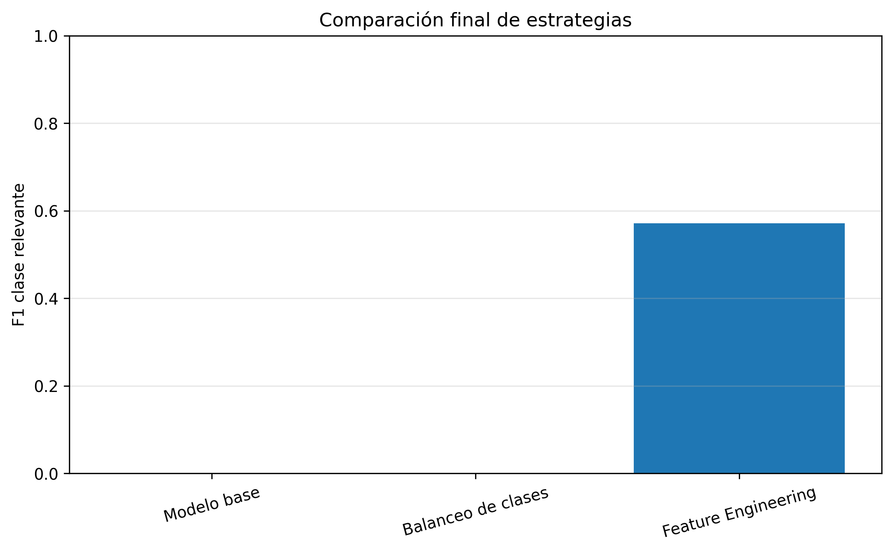
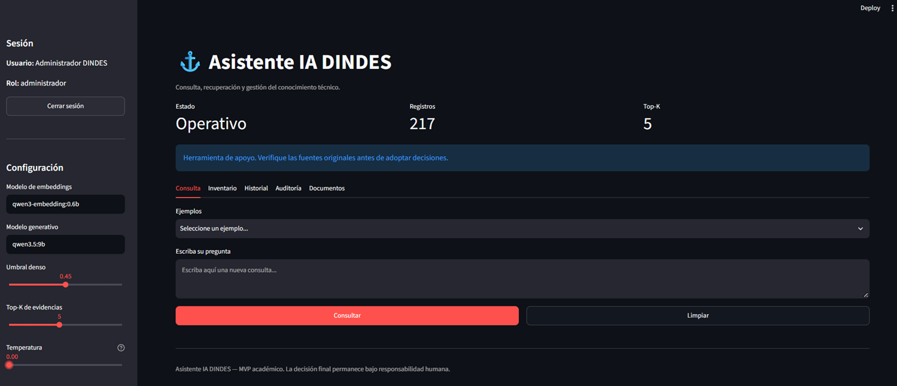
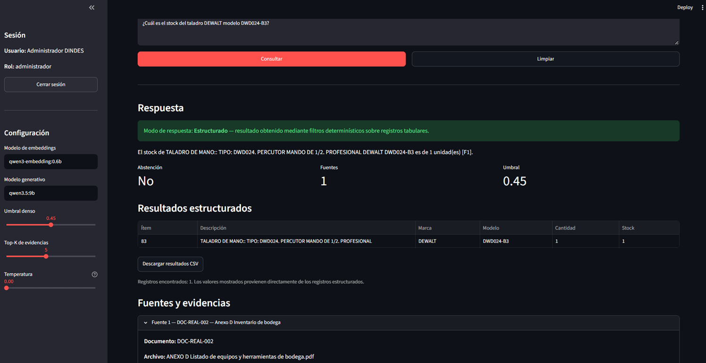
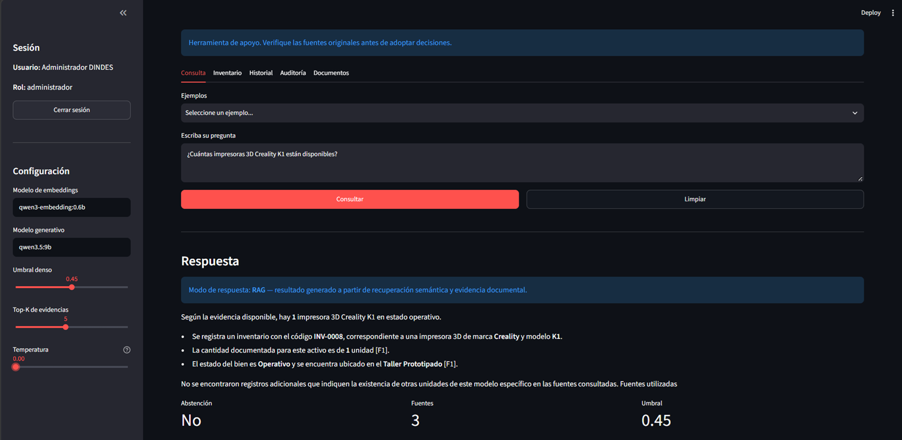
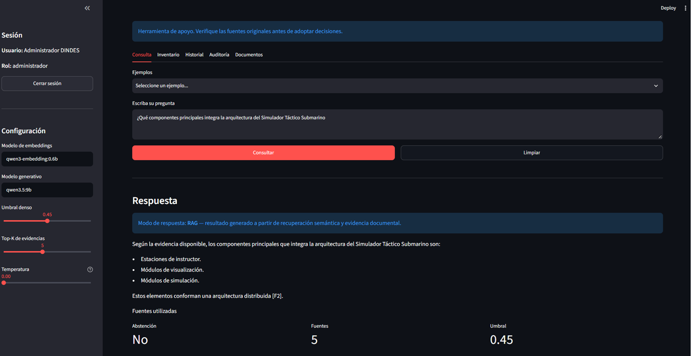
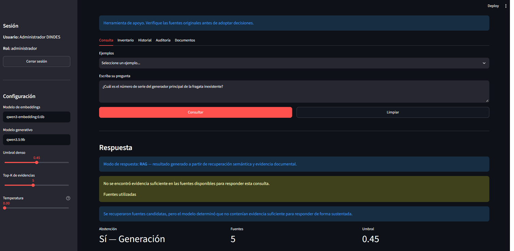

# ⚓ Asistente IA DINDES


**Asistente de IA para Innovación, Desarrollo y Gestión del Conocimiento Técnico — DINDES**

Proyecto académico del curso **Proyecto Integrador en Inteligencia Artificial (MIAR0545)** de la Universidad de Especialidades Espíritu Santo (UEES).

El sistema implementa un asistente basado en **RAG (Retrieval-Augmented Generation)** para recuperar conocimiento técnico, responder consultas con evidencia visible, consultar inventario estructurado y abstenerse cuando no existe evidencia suficiente. La arquitectura principal se diseñó para operación local/on-premise y se creó además una **versión cloud académica** para permitir evaluación remota con datos sintéticos o autorizados.

> 🌐 **Aplicación pública:** [Abrir Asistente IA DINDES](https://asistente-ia-dindes.streamlit.app/)

---

## Tabla de contenidos

1. [Problema](#problema)
2. [Usuarios objetivo](#usuarios-objetivo)
3. [Datos](#datos)
4. [Metodología](#metodología)
5. [Arquitectura](#arquitectura)
6. [Resultados](#resultados)
7. [Instalación y ejecución](#instalación-y-ejecución)
8. [Interfaz de usuario](#interfaz-de-usuario)
9. [Estructura del proyecto](#estructura-del-proyecto)
10. [Consideraciones éticas](#consideraciones-éticas)
11. [Limitaciones](#limitaciones)
12. [Autores y contribuciones](#autores-y-contribuciones)
13. [Licencia](#licencia)
14. [Referencias](#referencias)
15. [Videos](#videos)

---

## Problema

DINDES gestiona documentación técnica, antecedentes de proyectos, inventarios e información de apoyo que debe ser consultada de forma eficiente y trazable. La búsqueda manual puede consumir tiempo, fragmentar el conocimiento y dificultar la identificación de la fuente exacta que sustenta una respuesta.

El proyecto busca reducir ese problema mediante recuperación de información, consultas estructuradas y generación asistida con evidencia.

### Importancia

- Reduce tiempo de búsqueda de antecedentes.
- Facilita reutilización del conocimiento técnico.
- Mantiene trazabilidad hacia documentos y registros.
- Disminuye dependencia del conocimiento tácito.
- Introduce abstención explícita cuando la evidencia es insuficiente.

---

## Usuarios objetivo

El MVP está dirigido principalmente a personal técnico y administrativo autorizado, responsables de proyectos, analistas, especialistas y administradores del conocimiento.

La aplicación es una **herramienta de apoyo** y no sustituye decisiones técnicas, administrativas u operativas.

---

## Datos

El repositorio público utiliza datasets **sintéticos y académicos**.

| Dataset | Propósito |
|---|---|
| `Dataset_1_Documentacion_Tecnica_DINDES_Sample.csv` | Conocimiento documental de prueba |
| `Dataset_2_Inventario_Institucional_DINDES_Sample.csv` | Inventario sample |
| `Dataset_3_Evaluacion_QA_Asistente_IA_Sample.csv` | Preguntas y respuestas de evaluación |

Más detalle: [`data/README.md`](data/README.md).

---

## Metodología

El proyecto no realiza fine-tuning del LLM con documentación institucional. Se utiliza una arquitectura RAG:

1. carga y normalización;
2. segmentación y metadatos;
3. recuperación;
4. selección de evidencia;
5. respuesta con citas;
6. abstención cuando no existe evidencia suficiente.

Para inventario tabular existe una ruta **estructurada determinística**.

---

## Arquitectura

```text
Pregunta
   ↓
Enrutamiento
   ├── Estructurado → motor tabular
   └── Documental → retrieval → evidencia
                         ↓
                  Respuesta + fuentes
                         ↓
                    Streamlit UI
```

La versión cloud utiliza un backend ligero y reproducible que no depende de Ollama ni de pesos locales.

---

## Resultados

### Clasificador auxiliar

| Modelo | Accuracy | Precision | Recall | F1 |
|---|---:|---:|---:|---:|
| Modelo base | 0.8750 | 0.0000 | 0.0000 | 0.0000 |
| Balanceo de clases | 0.5000 | 0.0000 | 0.0000 | 0.0000 |
| Feature Engineering | 0.8125 | 0.4000 | 1.0000 | 0.5714 |



La validación contiene únicamente dos positivos; por ello estas métricas son demostrativas y no deben interpretarse como desempeño operacional.

### Validación funcional

| Caso | Resultado |
|---|---|
| DEWALT DWD024-B3 | Estructurado; stock = 1 |
| Creality K1 | RAG cuantitativo; cantidad = 1 |
| Simulador Táctico Submarino | RAG documental |
| Fragata inexistente | Abstención en retrieval |

Las métricas exportadas están en [`results/metrics/metricas_finales.csv`](results/metrics/metricas_finales.csv) y el resumen en [`results/reports/resumen_evaluacion.md`](results/reports/resumen_evaluacion.md).

---

## Instalación y ejecución

```powershell
py -m venv .venv
Set-ExecutionPolicy -Scope Process -ExecutionPolicy Bypass
.\.venv\Scripts\Activate.ps1
python -m pip install --upgrade pip
pip install -r requirements.txt
```

### Aplicación local

```powershell
streamlit run app/app.py
```

### Entrypoint cloud

```powershell
streamlit run streamlit_app.py
```

### Tests

```powershell
python -m unittest discover -s tests -p "test_*.py" -v
```

La suite validada ejecutó **13 pruebas con resultado OK**.

---

## Interfaz de usuario

La interfaz incluye autenticación, roles, consultas, fuentes, abstención, inventario, historial, auditoría, documentos, evaluación y herramientas de priorización.

### Capturas

#### Pantalla principal



#### Consulta estructurada



#### Consulta cuantitativa



#### Consulta documental RAG



#### Abstención responsable



---

## Estructura del proyecto

```text
asistente-ia-dindes/
├── README.md
├── requirements.txt
├── LICENSE
├── streamlit_app.py
├── docs/
├── data/
├── notebooks/
├── src/
├── models/
├── app/
├── tests/
└── results/
```

---

## Consideraciones éticas

El sistema incorpora:

- abstención ante evidencia insuficiente;
- trazabilidad de fuentes;
- revisión humana;
- control de acceso;
- separación entre datos públicos y datos institucionales;
- auditoría;
- análisis de privacidad, fairness, transparencia, impacto y uso dual.

Más detalle: [`docs/consideraciones_eticas.md`](docs/consideraciones_eticas.md).

---

## Limitaciones

- Los datasets públicos son pequeños y sintéticos.
- Las métricas académicas no representan desempeño operacional.
- La calidad depende de cobertura y vigencia del corpus.
- La versión cloud no replica todo el costo computacional del runtime local.
- La decisión final permanece bajo responsabilidad humana.

---

## Autores y contribuciones

### Juan Carlos Bajaña Gutiérrez
- arquitectura e integración del MVP;
- RAG e inventario;
- interfaz y despliegue cloud;
- evaluación técnica y documentación.

### José Luis Peñafiel Fernández
- análisis y desarrollo del proyecto integrador;
- revisión metodológica;
- documentación;
- evaluación académica.

---

## Licencia

Código publicado bajo **MIT License**. Consulte [`LICENSE`](LICENSE).

---

## Referencias

- Lewis, P. et al. (2020). *Retrieval-Augmented Generation for Knowledge-Intensive NLP Tasks*. NeurIPS.
- Pedregosa, F. et al. (2011). *Scikit-learn: Machine Learning in Python*. Journal of Machine Learning Research.
- Streamlit. *Streamlit Documentation*.
- Qwen Team. *Qwen documentation and technical resources*.
- McKinney, W. (2010). *Data Structures for Statistical Computing in Python*.
- Harris, C. R. et al. (2020). *Array programming with NumPy*. Nature.

---

## Videos

- **Video pitch (máximo 5 minutos):** pendiente de incorporar enlace.
- **Video de respuestas a preguntas:** pendiente de incorporar enlace.

Los enlaces se incorporarán en el commit final de entrega.
